# USB CABLE CHECKER Lite 사용 설명서

## 소개

USB 케이블 체커 Lite(USB Cable Checker Lite)는 USB 케이블의 결선 확인, 전원선 저항값 측정 등을 수행할 수 있는 USB 케이블 테스트 도구입니다.

**USB Cable Checker Lite 공식 페이지: http://bit-trade-one.co.jp/adusbcimle**

전원은 CR2032 코인형 배터리를 사용합니다.

다양한 케이블의 테스트를 지원합니다.

- USB-A – Micro-B (USB 2.0)
- Type-C – Micro-B
- USB-A – Type-C (USB 3.x)
- Type-C – Type-C (USB 2.0 / USB 3.x / 전체 결선)

※ USB4·Thunderbolt 케이블도 물리적 결선 확인은 가능하지만, 규격 식별은 불가능합니다.

## 각 부위 명칭 및 설명

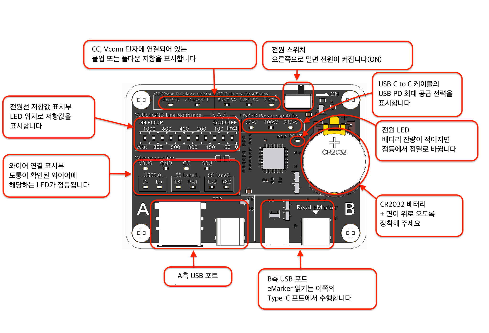

<!--  -->

## 사용 전 확인 및 주의사항

구매 시 USB Cable Checker Lite에는 동작 확인용 배터리가 장착되어 있습니다.  

절연용 시트가 본체와 배터리 사이에 끼워져 있으므로, 제거한 후 사용해 주세요.

또한 기판이 아크릴로 보호되어 있으나 커넥터 등이 노출되어 있으므로 취급에 주의해 주세요.

**본 제품은 케이블 검사 전용 디바이스입니다. 다른 USB 디바이스를 연결하지 마세요. 파손의 위험이 있습니다.**

배터리 교체 시에는 「배터리 교체 방법」을 읽고 올바른 방향으로 장착해 주세요. (배터리의 `+` 면이 위로 오도록 장착합니다.)

## 사용 방법

- **케이블 판정**

본 제품의 전원을 켠(ON) 후, A측 커넥터와 B측 커넥터를 USB 케이블로 연결합니다.

본 제품의 USB 포트에는 A측과 B측 구분이 있습니다. 왼쪽부터 A측 Type-C 포트, A측 USB-A 포트, B측 Micro-B 포트, B측 Type-C 포트 순서로 배치되어 있습니다.
USB 케이블을 테스트할 때는 반드시 A측 포트와 B측 포트의 커넥터를 서로 연결해 주세요.

**올바른 연결 방법**

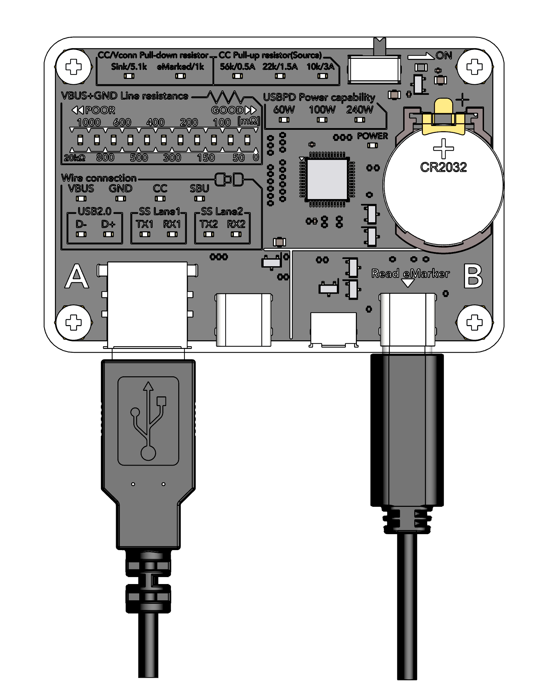

<!--  -->

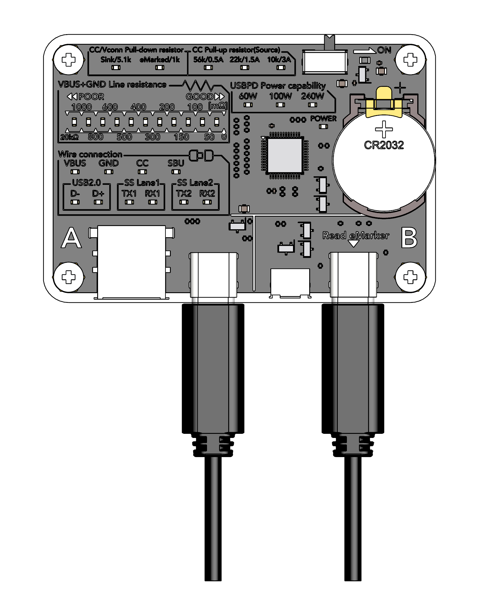

<!--  -->

**잘못된 연결 방법**

아래 그림과 같이 A측끼리 또는 B측끼리 포트를 연결하면 케이블이 테스트되지 않으므로 주의해 주세요.

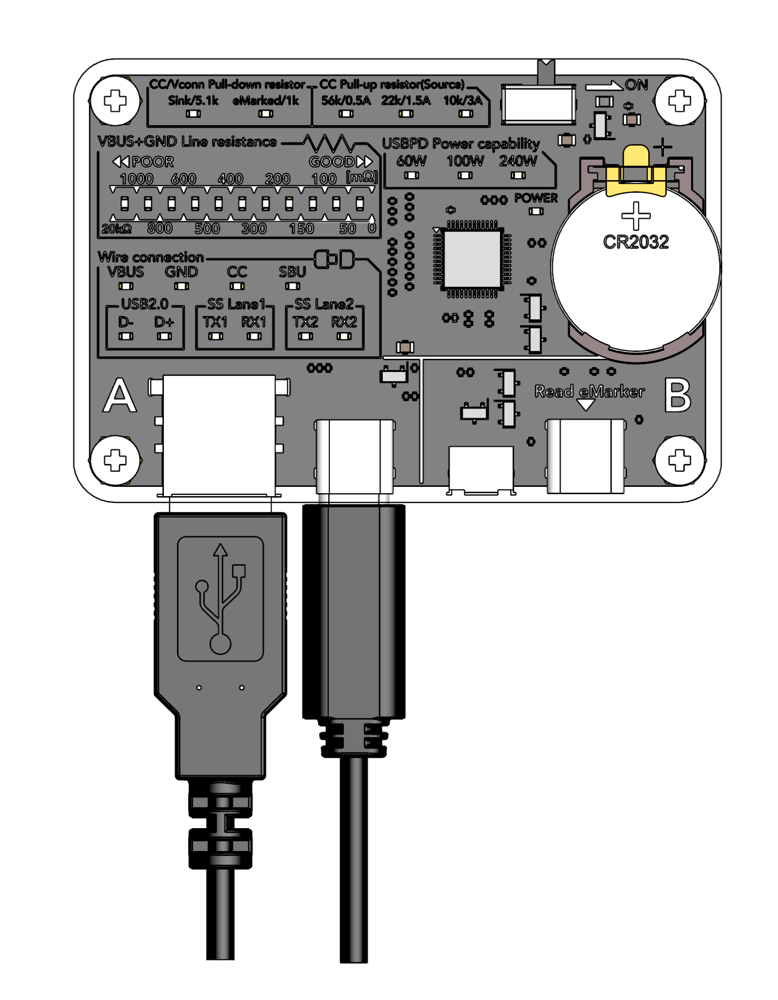

<!--  -->

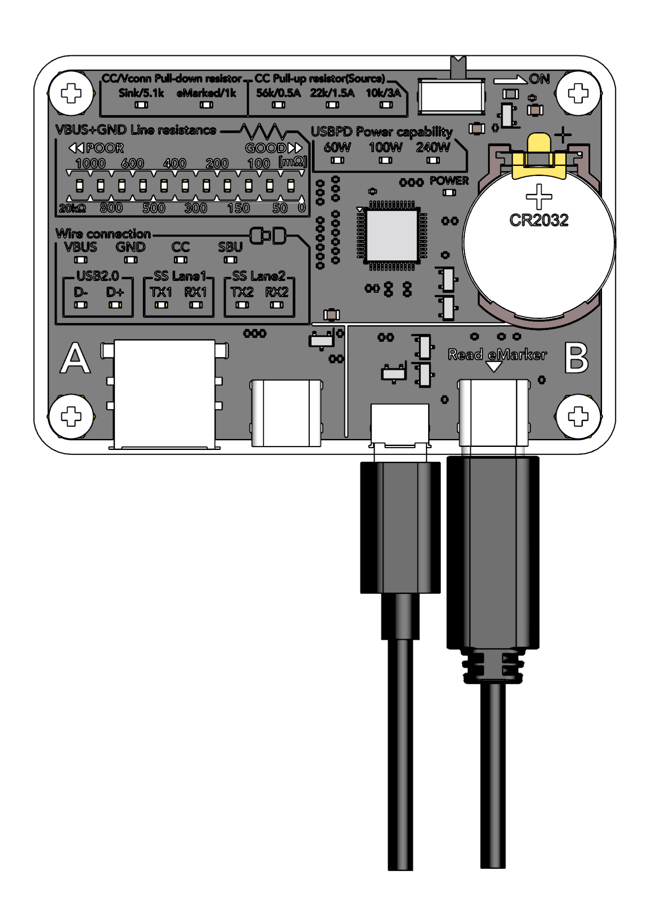

<!--  -->

와이어가 결선되어 있으면 「Wire connection(와이어 연결)」 부분에 해당하는 LED가 점등됩니다.

A측과 B측에 연결한 케이블의 VBUS와 GND가 **모두** 결선되어 있으면, 「VBUS+GND Line resistance(전원선 저항)」에 VBUS선과 GND선 저항값의 **합계** 저항값 기준치가 LED로 표시됩니다.

양쪽 끝이 모두 Type-C인 케이블을 연결하면, 해당 케이블의 최대 급전 능력을 「USBPD Power capability(USB PD 급전 능력)」에 LED로 표시합니다.

## 케이블 타입별 LED 표시 예시

**전원선만 있는 케이블 (충전 전용)**

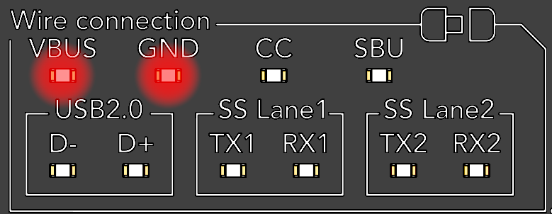

<!--  -->

**레거시 (Micro-B / USB-A) USB 2.0 케이블**

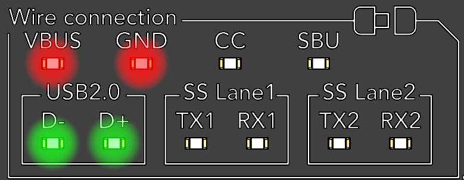

<!--  -->

**USB-A - Type-C USB 3.x 케이블**

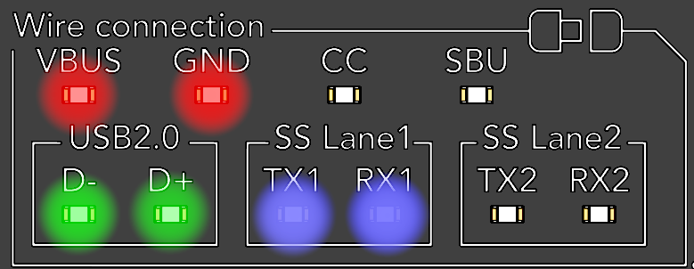

<!--  -->

**Type-C - Type-C USB 2.0 케이블**

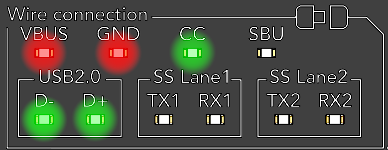

<!--  -->

**Type-C - Type-C 전체 결선(풀 스펙) 케이블**

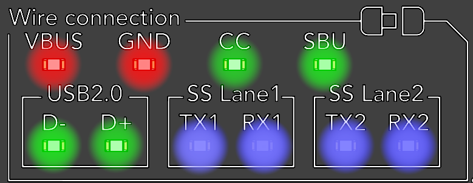

<!--  -->

## 와이어 결선 표시부 해설

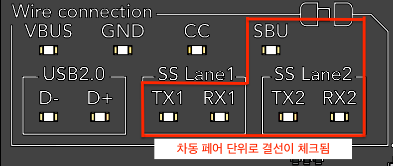

<!--  -->

결선되어 있는 와이어에 해당하는 LED가 켜집니다. D-, D+ 이외의 차동 페어(Differential Pair) 와이어인 SBU, TX1, RX1, TX2, RX2는 각각 차동 페어 단위로 결선이 체크되며, 이러한 차동 페어는 `+` 선과 `-` 선 양쪽이 모두 도통된 경우에만 LED가 켜집니다. 결선 여부 판정의 임계값은 20kΩ입니다.

### VBUS+GND Line resistance (VBUS+GND 선 저항)

본 제품에는 VBUS선과 GND선이 도통된 경우, VBUS선과 GND선의 저항값을 측정하여 그 합계값을 표시하는 기능이 있습니다. 단위는 mΩ(밀리옴)입니다. 20kΩ을 초과하는 경우에는 단선으로 판단됩니다.

**전원선 저항값 표시 예시 및 저항값 읽는 법**

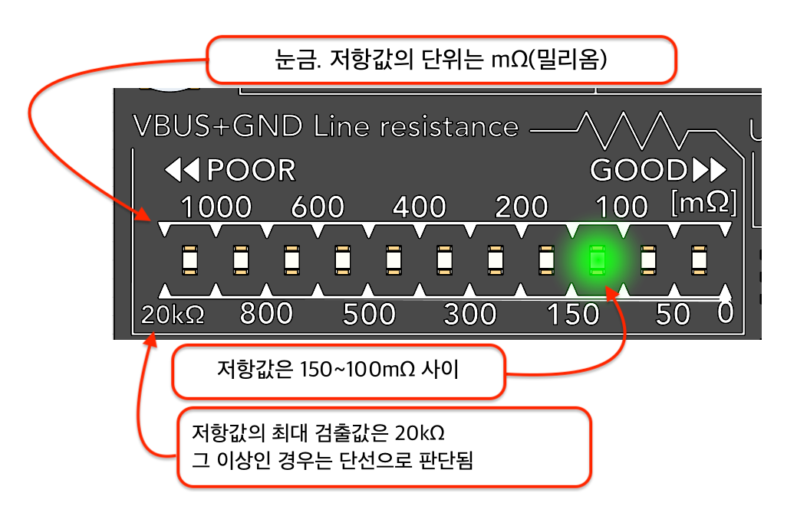

<!--  -->

예: 오른쪽에서 세 번째 LED가 점등되어 있을 때, 눈금 100과 150 사이의 LED가 켜진 것이므로 저항값은 100-150mΩ 사이라고 읽습니다.

### USB Power Delivery 급전 능력 표시부

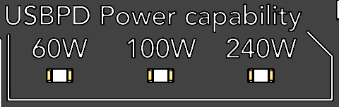

<!--  -->

양쪽 끝이 Type-C인 케이블의 USB PD 최대 급전 능력을 표시합니다. 플러그에 eMarker가 탑재되어 있는 경우에는 eMarker에서 읽어 들인 정보를 바탕으로 최대 급전 능력을 자동으로 판별합니다. 100W 또는 240W LED가 켜지는 경우 eMarker가 탑재된 케이블입니다.

양쪽 끝이 Type-C가 아닌 케이블이거나 CC선이 미결선된 경우에는 USB PD 급전 능력이 없는 케이블이므로 이 부분의 LED는 켜지지 않습니다.

**eMarker란?**

USB Type-C 케이블의 플러그 부분에 탑재된 IC 칩으로, 케이블의 사양(최대 전류, 전압, 데이터 전송 속도 등)을 기록하고 있습니다. 주로 60W를 초과하는 전력 공급을 지원하기 위해 필요하며, 이 데이터를 읽어 들임으로써 케이블이 어떤 기능을 지원하는지 판별할 수 있습니다.

### CC/Vconn 저항 표시부

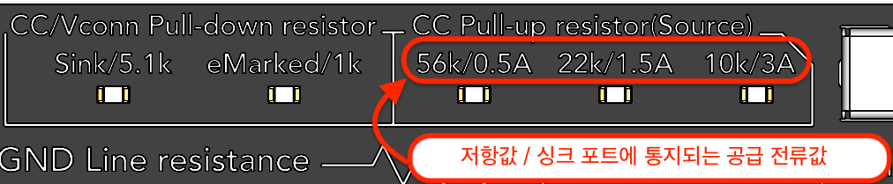

<!--  -->

Type-C 플러그의 CC 단자 또는 Vconn 단자와 GND 간 혹은 VBUS 간의 저항이 검출된 경우, 해당 저항값을 표시합니다. 왼쪽의 LED 2개는 풀다운 저항, 오른쪽 3개는 풀업 저항(저항값 / 싱크 포트에 통지되는 공급 전류값)의 존재를 나타냅니다.

**CC/Vconn Pull-down resistor (풀다운 저항)**
- **Sink/5.1k**: CC에 5.1kΩ의 풀다운 저항이 연결되어 있습니다. 이 저항을 통해 포트 파트너에게 싱크(Sink, 수전) 포트임이 통지됩니다.
- **eMarked/1k**: Vconn에 1kΩ의 풀다운 저항이 연결되어 있으며, 플러그 내부의 eMarker 존재를 나타냅니다.

**CC Pull-up resistor (Source) (풀업 저항)**
- **56k/0.5A**: CC에 56kΩ의 풀업 저항이 연결되어 있습니다. 포트 파트너에게 통지되는 급전 능력은 0.5A입니다. (보충: USB Type-C 규격에서는 일반적으로 이 저항값의 풀업 저항을 플러그에 실장하는 것이 허용되지 않습니다.)
- **22k/1.5A**: CC에 22kΩ의 풀업 저항이 연결되어 있습니다. 포트 파트너에게 통지되는 급전 능력은 1.5A입니다.
- **10k/3A**: CC에 10kΩ의 풀업 저항이 연결되어 있습니다. 포트 파트너에게 통지되는 급전 능력은 3.0A입니다.

### Wire connection (와이어 연결)

<!--  -->

케이블 내부에 실제로 결선되어 있는 와이어를 표시합니다. 결선 판정 임계값은 20kΩ입니다.

- **VBUS, GND**: 전원 공급에 사용되는 와이어입니다.
- **CC**: Type-C 케이블에서 주로 호스트·디바이스 식별이나 USB PD 통신에 사용되는 와이어입니다. 다양한 기능을 「사용할 수 있는지 여부」가 이 와이어를 통해 디바이스 간에 교환됩니다.  
- **SBU**: Side Band Use로서 USB 데이터 통신 이외의 데이터(음성이나 영상 등)를 주고받을 때 사용하는 와이어입니다. 주로 얼터네이트 모드(Alternate Mode)에서 이용됩니다.  
- **USB2.0 D-/D+**: USB 2.0까지의 데이터 통신(Low Speed, Full Speed, High Speed)에서 사용되는 와이어입니다.
- **SS Lane 1, SS Lane 2**: USB 3.0 이상에서의 통신(SuperSpeed, SuperSpeed+)에 사용되는 와이어입니다.

SBU, SS Lane 1, SS Lane 2의 LED는 차동 페어 단위로 결선을 체크합니다. `+` 선과 `-` 선 양쪽이 모두 도통되어 있는 경우에만 LED가 점등됩니다.

## 배터리 교체 방법

본 제품의 배터리는 CR2032 배터리를 사용합니다. 스위치를 켜도 전원이 들어오지 않거나 전원 LED가 깜빡이기 시작하면 배터리가 소모된 상태이므로 아래 절차에 따라 배터리를 교체해 주세요.

① 본 제품의 전원을 끕니다(OFF). \
② 드라이버를 사용해 상단의 나사 4개를 풀어 전면 커버를 분리합니다. \
③ 손톱 등으로 아래 그림의 전극 탭을 옆으로밉니다.

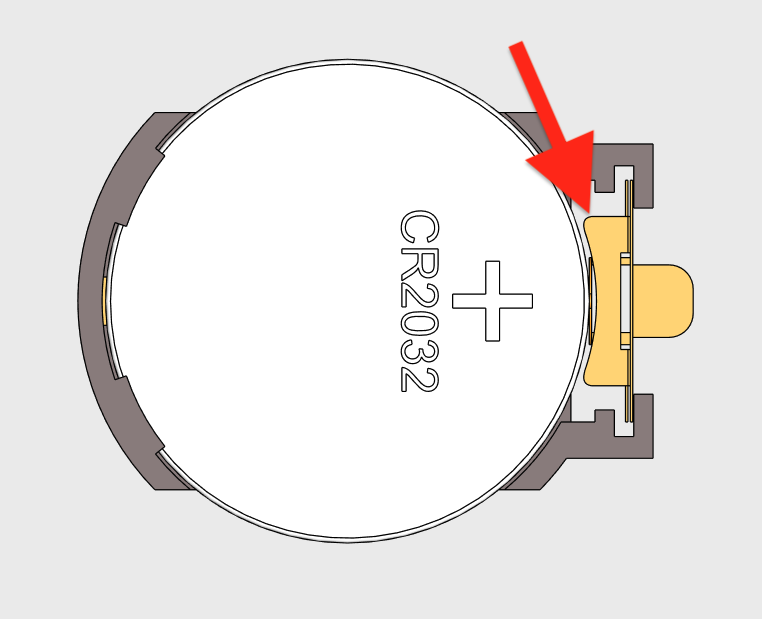

<!--  -->

④ 전극 탭을 옆으로 민 상태에서 배터리를 위로 빼냅니다.

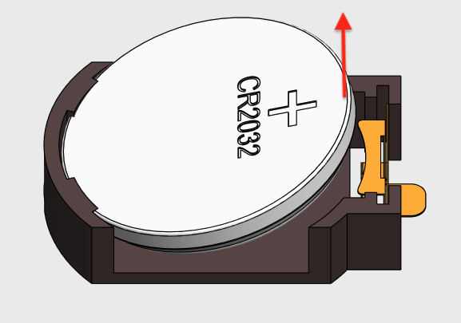

<!--  -->

⑤ 새 배터리를 `+`(플러스) 면이 위로 오도록 하여 한쪽을 전극 탭 아래에 넣은 뒤 위에서 눌러 장착합니다.

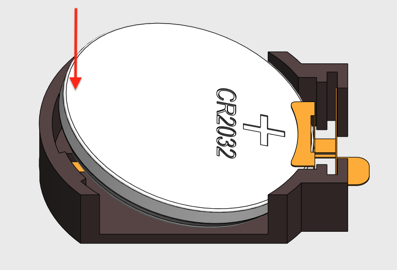

<!--  -->

⑥ 분리했던 전면 커버를 다시 장착합니다.

위 이미지와 같이 마이너스 단자와 배터리 사이의 틈에 일자 드라이버 끝을 밀어 넣어 지렛대 원리를 이용해 분리할 수도 있습니다.

그 후 새 CR2032 배터리의 플러스(`+`) 측이 위로 오도록 장착합니다.

## USB Cable Checker 3와 Lite 비교

**USB Cable Checker 3**는 케이블과 포트 양쪽의 체크를 모두 지원합니다. 체크 결과는 LCD 디스플레이에 텍스트와 수치로 표시됩니다. 케이블, USB 충전기, 태블릿이나 노트북 포트 등 다양한 상황에서의 점검에 활용할 수 있습니다.

**USB Cable Checker Lite**는 케이블 체크에 특화된 심플한 구성으로, 체크 결과를 LED로 표시합니다.
코인 배터리 하나로 동작하며, 가볍고 얇아 휴대성이 뛰어납니다.

| 기능 / 사양 | USB Cable Checker 3 | USB Cable Checker Lite |
|---:|---|---|
| **―― 케이블 체크 ――** |  |  |
| 와이어 도통·단선 체크 (VBUS, GND, CC, SBU, D+/D-, TX1/RX1, TX2/RX2) | ✓ LCD 디스플레이에 표시 | ✓ LED 점등 |
| 케이블 타입 자동 판별 | ✓ | ✓ LED 점등 패턴으로 판별 |
| VBUS+GND 저항값 측정 | ✓ 수치로 표시 (mΩ) | ✓ LED 눈금으로 기준치 표시 (mΩ) |
| CC 풀업/풀다운 저항값 표시 | ✓ 실측값을 LCD에 텍스트로 표시 (예: 56kΩ 풀업) | ✓ 전용 LED 패널로 직접 표시 (Sink/5.1k, 56k/0.5A, 22k/1.5A, 10k/3A 등) |
| eMarker 읽기 | ✓ 상세 데이터 표시 (USB4 Gen3 / USB3.x / USB2 등, 최대 전압·전류) | ✓ 급전 능력(60/100/240W)만 표시 |
| **―― 포트 체크 ――** |  |  |
| USB 포트의 Power role 확인 | ✓ Source / Sink / DRP | — |
| PDO 취득·목록 표시 | ✓ Fixed / PPS / EPR AVS 등 | — |
| EPR (240W) 지원 확인 | ✓ | — |
| Alternate Mode 지원 확인 | ✓ DisplayPort / Thunderbolt | — |
| 충전 모드 분석 (D+/D-) | ✓ DCP / Apple divider / QuickCharge | — |
| Discover Identity 응답 확인 | ✓ | — |
| **―― 조작·모드 ――** |  |  |
| 동작 모드 | 케이블 / 포트 / AUTO 자동 전환 지원 | 케이블 체크 전용 |
| 자동 전원 꺼짐 (Auto Power Off) | ✓ 3분 무조작 시 OFF | — |
| 배터리 잔량 표시 | ✓ 배터리 종류 선택으로 정밀도 향상 | ✓ 전원 LED 점멸로 경고 |
| **―― 지원 커넥터 ――** |  |  |
| USB Type-C (A/B 양측) | ✓ | ✓ |
| USB Type-A (A측) | ✓ | ✓ |
| Micro-B (B측) | ✓ | ✓ |
| **―― 스펙 ――** |  |  |
| 전원 | AAA 배터리 × 2 (알칼리 / 망간 / 니켈수소) | CR2032 코인 배터리 |
| 본체 크기 | 약 70×40×22 mm | 약 76×52×15 mm |
| 중량 (배터리 포함) | 약 65 g | 약 40 g |
| 표시 방식 | 1.77인치 LCD (텍스트·수치) | LED 인디케이터 |
